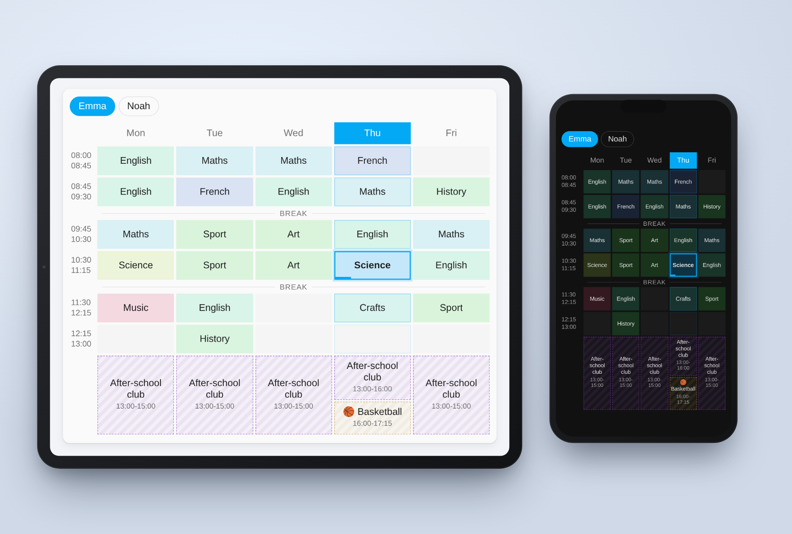
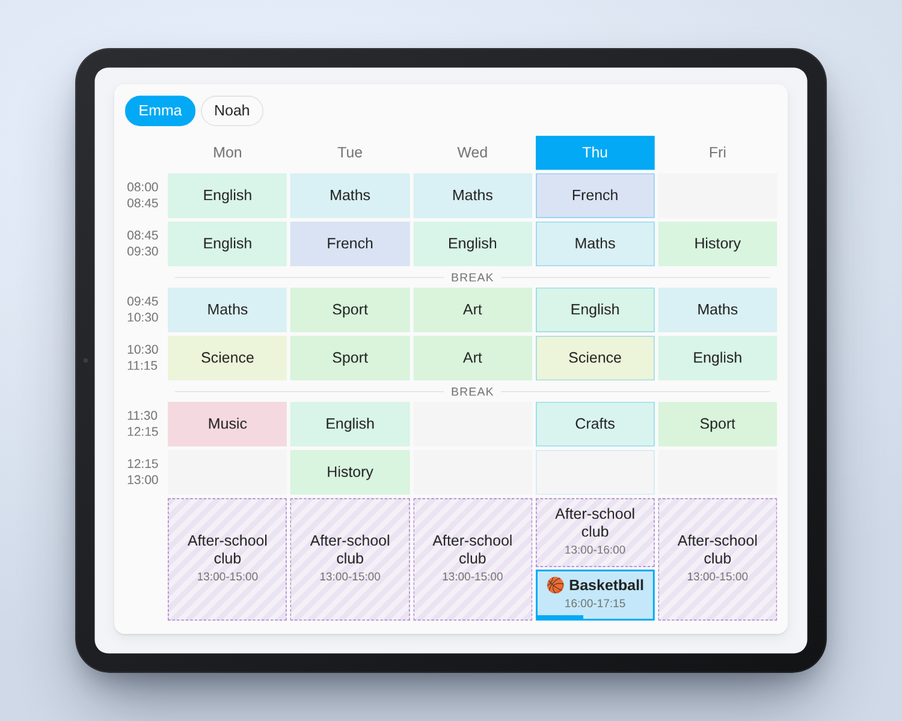
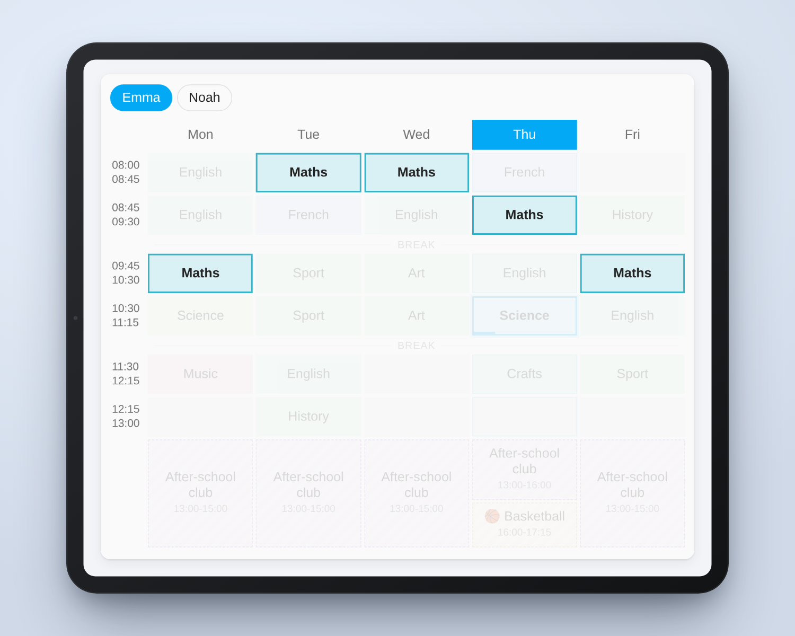
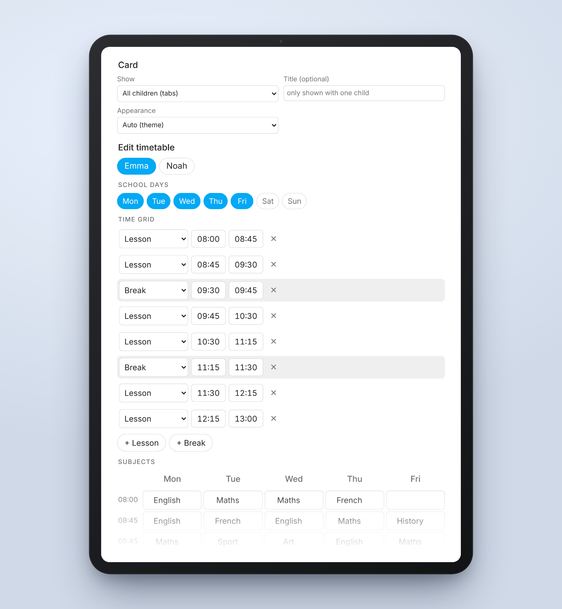
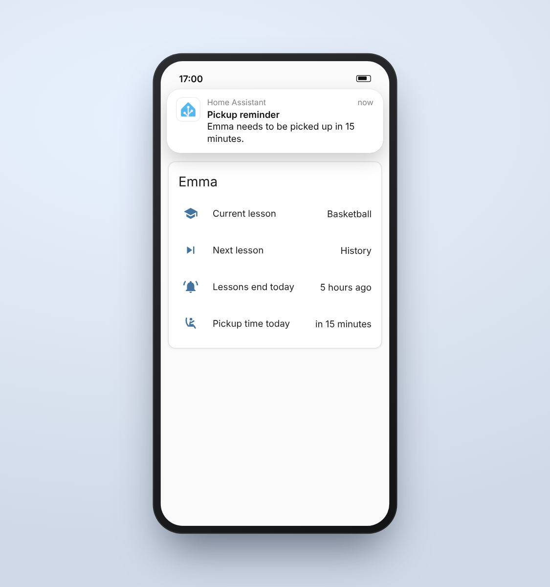

<p align="center">
  
</p>

<h1 align="center">Sleek School Schedule</h1>

<p align="center">
  A school timetable for Home Assistant that is easy to set up and looks good on any dashboard.
</p>

<p align="center">
  <a href="https://github.com/hacs/integration"></a>
  <a href="https://github.com/beatschubser/ha-sleek-school-schedule/releases"></a>
  <a href="https://github.com/beatschubser/ha-sleek-school-schedule/actions/workflows/validate.yml"></a>
</p>

> [!WARNING]
> **Work in progress.** This integration is under active development and not officially released yet. Features, sensor attributes and settings may still change between versions. Feedback and bug reports are welcome via [issues](https://github.com/beatschubser/ha-sleek-school-schedule/issues).



## Features

I wanted our school timetables in Home Assistant. The existing integrations I tried were not my cup of tea, so I had my own built.

> [!NOTE]
> All features are based on my own ideas, but the code is 100% AI-generated. I just want to be transparent about that.

- You set up times, subjects and afternoon activities directly in the card editor of your dashboard, with a live preview.
- The current lesson is highlighted and shows a progress bar. This also works for breaks and afternoon activities.
- Afternoon activities can be different on every day, for example after-school club until 4 pm on Thursday and basketball afterwards.
- One timetable per child, shown as tabs in one card or in separate cards.
- School days can be chosen per child, for example Monday to Saturday.
- Tap a subject and you see every lesson of that subject in the week.
- Sensors for the current lesson, the next lesson, the end of lessons and the pickup time, so you can use the timetable in automations.
- Every subject gets its own color automatically.
- Light and dark mode are supported.
- Available in English, German, French, Dutch, Spanish, Italian and Polish.

| Afternoon activity running | Tap a subject to highlight it |
| --- | --- |
|  |  |

## Installation

### HACS (recommended)

1. In HACS, open the menu (three dots, top right) and choose **Custom repositories**.
2. Add `https://github.com/beatschubser/ha-sleek-school-schedule` with type **Integration**.
3. Search for **Sleek School Schedule**, install it and restart Home Assistant.

### Manual

Copy the folder `custom_components/sleek_school_schedule` into the `custom_components` folder of your Home Assistant configuration and restart Home Assistant.

## Setup

1. **Settings > Devices & services > Add integration > Sleek School Schedule.** Enter the name of the child. Repeat for every child.
2. **Add the card** to a dashboard: search for "Sleek School Schedule" in the card picker, or use

   ```yaml
   type: custom:sleek-school-schedule-card
   ```

3. **Fill in the timetable:** edit the dashboard, open the card and edit the school days, time grid, subjects and afternoon on the left. Click **Save timetable**.

The card is registered as a dashboard resource automatically. Only if your dashboards run in YAML mode, add `/sleek_school_schedule_files/sleek-school-schedule-card.js` as a JavaScript module resource yourself.

### Card options

| Option | Description |
| --- | --- |
| `child` | Show only this child (name). Without it, all children are shown as tabs. |
| `title` | Custom title (only shown when the card displays a single child). |
| `appearance` | `auto` (default, follows your Home Assistant theme), `light` or `dark`. |

All options can be set in the visual card editor. Layout settings of the dashboard (size in sections, visibility) are kept.

The timetable itself (school days, time grid, subjects, afternoon) is not part of the card configuration. It is stored in Home Assistant per child and edited in the same editor, so several cards always show the same data.



## Sensors

Every child gets four sensors. Entity IDs are created in your Home Assistant language, e.g. `sensor.emma_current_lesson` in English.

| Sensor | State | Attributes |
| --- | --- | --- |
| Current lesson | Subject, break, free period or "Free" | `type`, `lesson`, `start`, `end` |
| Next lesson | Next subject or afternoon activity of the day, "Free" after the last one | `type`, `lesson`, `start`, `end`, `starts_at` |
| Lessons end today | Timestamp of the last lesson of the day | |
| Pickup time today | Timestamp of the end of the day, including afternoon activities | |

`type` is one of `lesson`, `break`, `free_period`, `afternoon` or `none`, independent of the language. Use it in automations instead of the state text.

<p align="center"></p>

### Example: reminder before pickup

```yaml
automation:
  - alias: "Pickup reminder"
    triggers:
      - trigger: time
        at:
          entity_id: sensor.emma_pickup_time_today
          offset: "-00:15:00"
    actions:
      - action: notify.mobile_app_my_phone
        data:
          message: "Emma needs to be picked up in 15 minutes."
```

## Reporting problems

Please [open an issue](https://github.com/beatschubser/ha-sleek-school-schedule/issues) and attach the diagnostics: **Settings > Devices & services > Sleek School Schedule**, three dots next to the child, **Download diagnostics**. The file contains the timetable of that child and the current sensor values, nothing else.

## Translations

All texts live in one JSON file per language:

- `custom_components/sleek_school_schedule/frontend/i18n/<language>.json` for the card, the editor and the sensor values
- `custom_components/sleek_school_schedule/translations/<language>.json` for the setup dialog and sensor names

To add a language, copy the English files, translate them and open a pull request. Corrections to existing translations are very welcome as well.

## License

[MIT](LICENSE)
