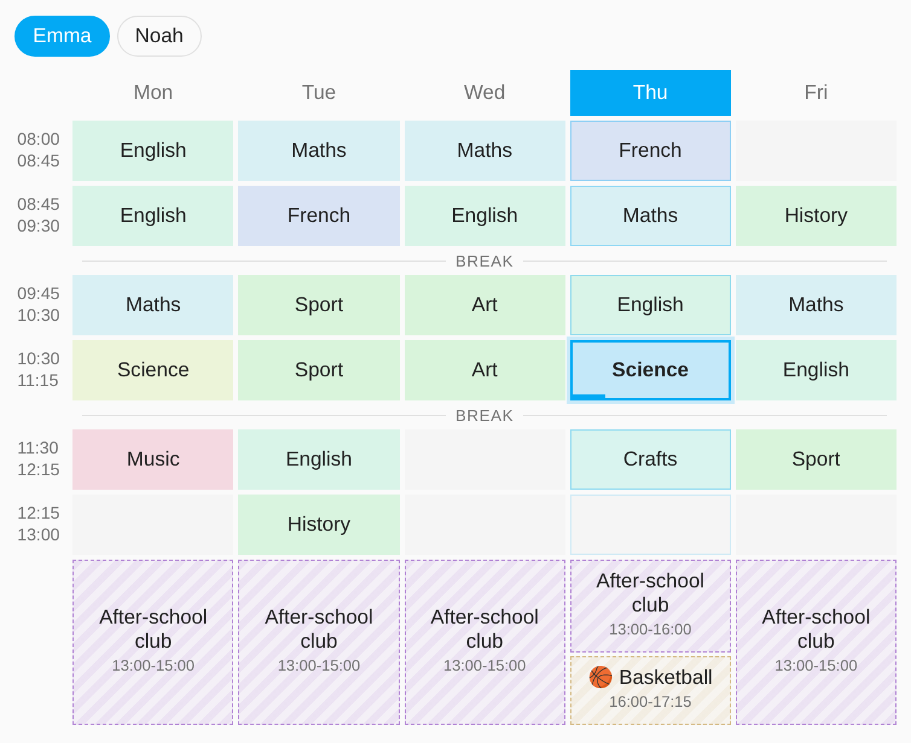
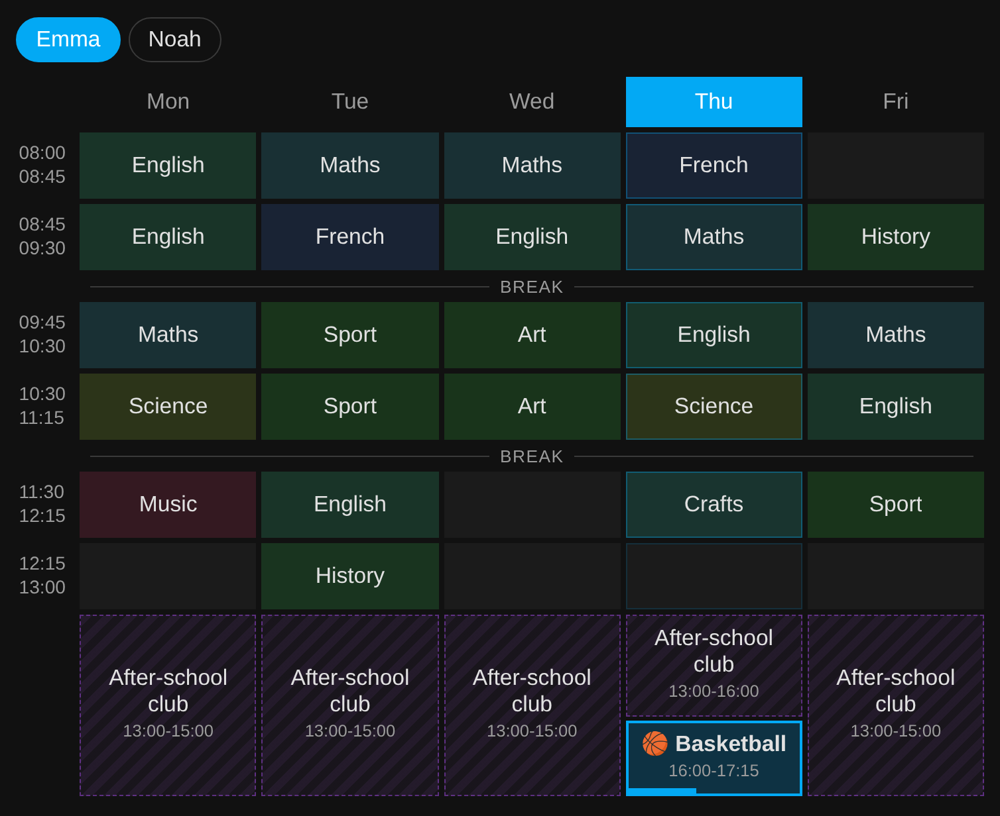
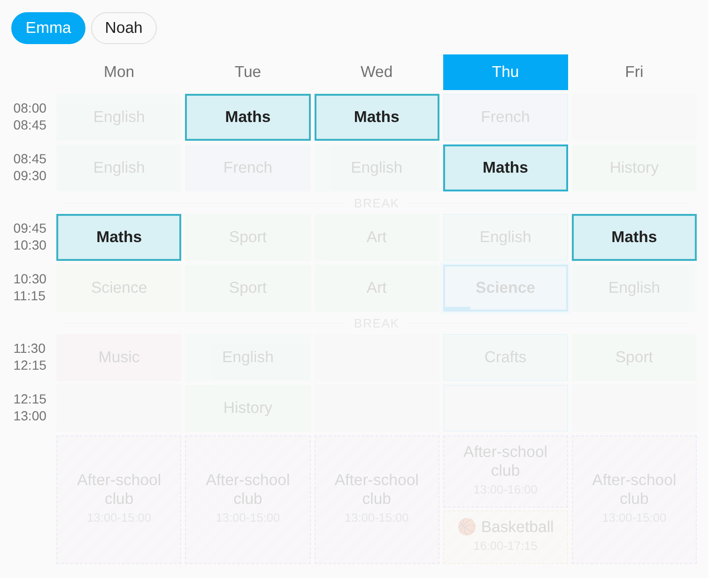
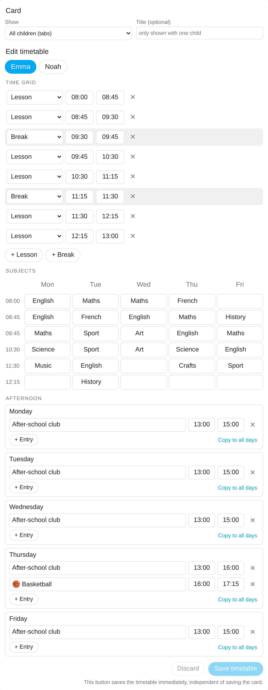

<p align="center">
  
</p>

<h1 align="center">Sleek School Schedule</h1>

<p align="center">
  A clean school timetable for Home Assistant: set it up in the dashboard, see the current lesson at a glance, and use it in automations.
</p>

<p align="center">
  <a href="https://github.com/hacs/integration"></a>
  <a href="https://github.com/beatschubser/ha-sleek-school-schedule/actions/workflows/validate.yml"></a>
</p>



## Features

- **Edit everything in the card editor.** No YAML, no config flow marathon: time grid, subjects and afternoon activities are edited right in the dashboard card editor, with a live preview.
- **Current lesson highlighted** with a progress bar, also during breaks and afternoon activities.
- **Afternoon per day.** After-school care, clubs and sports get their own times on each day (e.g. care until 4 pm, then basketball until 5:15 pm), without bloating the time grid.
- **Several children.** One timetable per child, shown as tabs or as separate cards.
- **Tap a subject** to highlight all its lessons in the week.
- **Sensors for automations:** current lesson, next lesson, end of lessons and pickup time.
- **Automatic colors** per subject, light and dark mode, works on phones, tablets and wall panels.
- **7 languages:** English, German, French, Dutch, Spanish, Italian and Polish. Weekday names follow your Home Assistant language automatically.

| Dark mode, afternoon activity running | Tap a subject to highlight it |
| --- | --- |
|  |  |

## Installation

### HACS (recommended)

1. In HACS, open the menu (three dots, top right) and choose **Custom repositories**.
2. Add `https://github.com/beatschubser/ha-sleek-school-schedule` with type **Integration**.
3. Search for **Sleek School Schedule**, install it and restart Home Assistant.

### Manual

Copy the folder `custom_components/sleek_school_schedule` into the `custom_components` folder of your Home Assistant configuration and restart Home Assistant.

## Setup

1. **Settings > Devices & services > Add integration > Sleek School Schedule.** Enter the name of the child. Repeat for every child.
2. **Add the card** to a dashboard: search for "Sleek School Schedule" in the card picker, or use

   ```yaml
   type: custom:sleek-school-schedule-card
   ```

3. **Fill in the timetable:** edit the dashboard, open the card and edit the time grid, subjects and afternoon on the left. Click **Save timetable**.

The card is registered as a dashboard resource automatically. Only if your dashboards run in YAML mode, add `/sleek_school_schedule_files/sleek-school-schedule-card.js` as a JavaScript module resource yourself.

### Card options

| Option | Description |
| --- | --- |
| `child` | Show only this child (name). Without it, all children are shown as tabs. |
| `title` | Custom title (only shown when the card displays a single child). |



## Sensors

Every child gets four sensors. Entity IDs are created in your Home Assistant language, e.g. `sensor.emma_current_lesson` in English.

| Sensor | State | Attributes |
| --- | --- | --- |
| Current lesson | Subject, break, free period or "Free" | `type`, `lesson`, `start`, `end` |
| Next lesson | Next subject or afternoon activity (also on the next school day) | `type`, `lesson`, `start`, `end`, `starts_at` |
| Lessons end today | Timestamp of the last lesson of the day | |
| Pickup time today | Timestamp of the end of the day, including afternoon activities | |

`type` is one of `lesson`, `break`, `free_period`, `afternoon` or `none`, independent of the language. Use it in automations instead of the state text.

### Example: reminder before pickup

```yaml
automation:
  - alias: "Pickup reminder"
    triggers:
      - trigger: time
        at:
          entity_id: sensor.emma_pickup_time_today
          offset: "-00:15:00"
    actions:
      - action: notify.mobile_app_my_phone
        data:
          message: "Emma needs to be picked up in 15 minutes."
```

## Translations

All texts live in one JSON file per language:

- `custom_components/sleek_school_schedule/frontend/i18n/<language>.json` for the card, the editor and the sensor values
- `custom_components/sleek_school_schedule/translations/<language>.json` for the setup dialog and sensor names

To add a language, copy the English files, translate them and open a pull request. Corrections to existing translations are very welcome as well.

## Requirements

- Home Assistant 2024.7 or newer
- The integration icon is shown from Home Assistant 2026.3 on

## Deutsch

Sleek School Schedule ist ein Stundenplan für Home Assistant. Zeitraster, Fächer und Nachmittagsbetreuung werden direkt im Karteneditor des Dashboards gepflegt, die aktuelle Stunde wird hervorgehoben, und Sensoren für aktuelle Stunde, nächste Stunde, Unterrichtsende und Abholzeit stehen für Automationen bereit. Installation und Einrichtung wie oben beschrieben, die Oberfläche erscheint automatisch auf Deutsch, wenn Home Assistant auf Deutsch eingestellt ist.

## License

[MIT](LICENSE)
